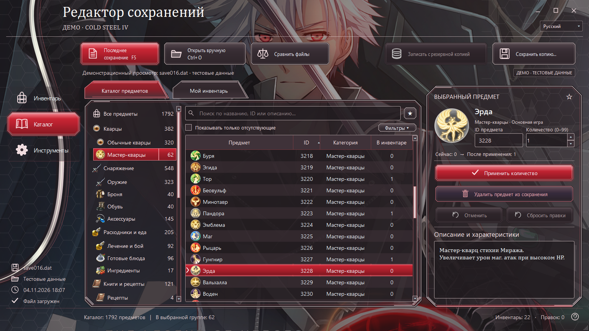
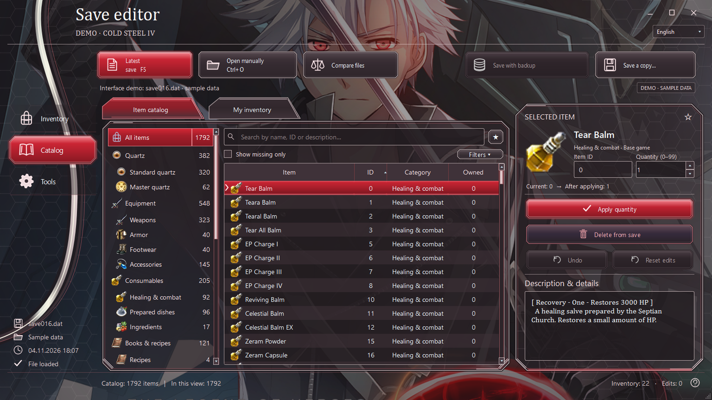
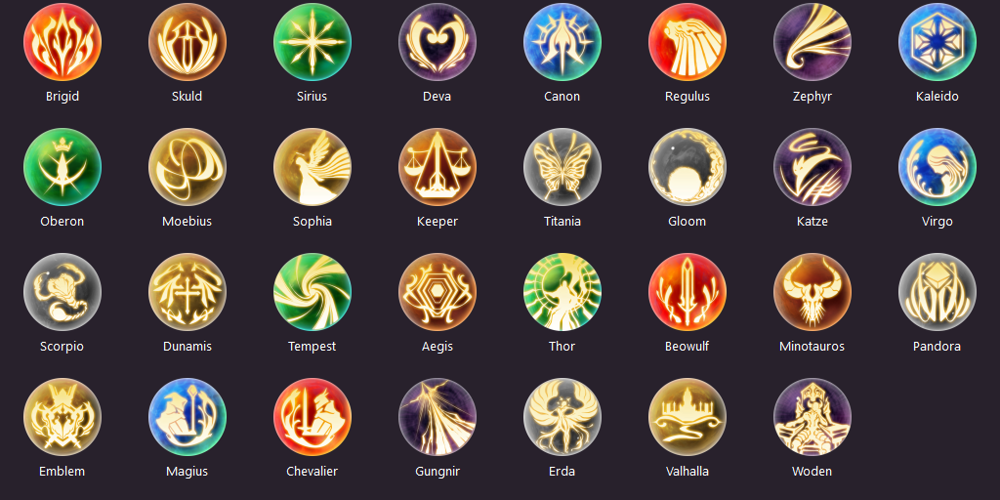

<div align="center">

# Cold Steel IV · Save Editor

**Редактор инвентаря для The Legend of Heroes: Trails of Cold Steel IV**

Игровое оформление · Русский и English · Нативное приложение Windows

[](CHANGELOG.md)


[](LICENSE)

**Русский** · [English](README_EN.md)

[Возможности](#возможности) · [Скриншоты](#скриншоты) · [Запуск](#запуск) · [Разработка](#разработка)



*«Багровая сталь»: графитовые панели, серебристые рамки и красные акценты.*

</div>

Редактор открывает сохранения **NISA PC**, показывает инвентарь и каталог установленной игры и позволяет менять предметы без запуска CS4. Изменения остаются в памяти до записи файла: можно отменить правку, просмотреть результат и сохранить отдельную копию.

> **0.1.2 — предварительная версия.** Чтение, запись, CRC, резервные копии и интерфейс проверены; загрузка изменённого файла самой игрой ещё не подтверждена. Для первого игрового испытания используйте копию сохранения.

## Возможности

| | Что доступно |
|---|---|
| **Инвентарь и каталог** | Поиск по названию, ID и описанию; категории, сортировка и фильтры |
| **Редактирование** | Количество 0–99, добавление и удаление, массовые операции |
| **Контроль изменений** | Отмена, сброс и список всех правок перед записью |
| **Сохранение** | Отдельная копия; перезапись с резервной копией; проверка CRC и внешних изменений файла |
| **Удобство** | Избранное, недавние предметы, поиск последнего сохранения, сравнение файлов и CSV |
| **Два языка** | Интерфейс RU/EN; отдельные русские и английские записи каталога |
| **DLC** | Сканирование таблиц установленной игры и русский перевод 103 стандартных предметов DLC |
| **Мастер-кварцы** | 31 исходное изображение CS4; проверены все 62 обычные и EX-записи на обоих языках |

## Скриншоты

Скриншоты сделаны в реальном Qt-интерфейсе. Количества и сохранение в демонстрации искусственные.

### Русский интерфейс


### English interface



<details>
<summary><strong>Все 31 изображение мастер-кварцев CS4</strong></summary>



Обычная и EX-версия используют одно изображение соответствующего мастер-кварца. Иконки получены из установленной игры, без генерации или перерисовки.

</details>

## Запуск

### Из исходников

Нужны **Windows**, **Python 3.10+** и установленная **Trails of Cold Steel IV — NISA PC**. Python доступен на [официальном сайте](https://www.python.org/downloads/).

```powershell
git clone https://github.com/Sqzzzzzzz/Cold-Steel-IV-Save-Editor..git Cold-Steel-IV-Save-Editor
cd Cold-Steel-IV-Save-Editor
.\Запустить.bat
```

При первом запуске скрипт создаст отдельное виртуальное окружение и установит PySide6 и Pillow. Для этого потребуется интернет.

1. Выберите корневую папку игры с каталогом `data`.
2. Откройте `saveXXX.dat` или воспользуйтесь поиском последнего сохранения.
3. Выберите предмет, задайте количество и нажмите **«Применить количество»**.
4. Проверьте список правок и выберите **«Сохранить копию…»**.

Обычная папка сохранений: `%USERPROFILE%\Saved Games\FALCOM\ed8_psv4`.

**Только посмотреть интерфейс:** запустите `Preview_CS4.bat`. Запись демонстрационного сохранения отключена.

### Собрать Windows EXE

```powershell
.\Собрать_EXE.bat
```

Скрипт запускает тесты, собирает программу, проверяет EXE и создаёт ZIP. Результаты находятся в `dist/` и `release/`. Готовому EXE отдельная установка Python не нужна. Сгенерированные EXE и окружение в Git не включаются.

## Каталог и языки

Предметы основной игры и DLC читаются из локальных `t_item.tbl` / `t_item_en.tbl`. Игровые таблицы и пользовательские сохранения в репозитории отсутствуют.

Переключатель языка меняет интерфейс и выбирает соответствующий текст каталога. При неполном английском кэше редактор повторно сканирует выбранную установку. Если русификатор заменил единственный английский файл, импортируйте оригинальный `t_item_en.tbl` через **«Инструменты → Импорт английского каталога»**. Русские записи при этом сохраняются.

Для 103 стандартных DLC встроен русский перевод названий и описаний. Установленный русский текст и пользовательские правки имеют приоритет.

## Поддерживаемый формат

- **NISA PC GameData (3, 2)**, несжатый файл размером **1 463 976 байт**.
- Сохранения PS4, Switch, CLE и неподдерживаемые структуры отклоняются.
- Запись обновляет контрольную сумму и сохраняет данные вне инвентаря.
- Для других типов предметов часть изображений остаётся общими иконками CS3. Для мастер-кварцев используются исходные текстуры CS4.

## Разработка

```powershell
python -m venv .qt-preview-venv
.\.qt-preview-venv\Scripts\python.exe -m pip install -r requirements-dev.txt
.\.qt-preview-venv\Scripts\python.exe -m pytest -q
.\.qt-preview-venv\Scripts\python.exe qt_window.py --self-test --self-test-report checks/report.json
```

Последняя локальная проверка: **84 теста прошли, 1 пропущен**. Исходная программа, собранный Windows EXE и демо прошли самопроверки. Подробности и границы проверки: [Validation / Проверки](docs/VALIDATION.md).

| Файл | Назначение |
|---|---|
| `qt_window.py` | Главное окно и взаимодействие с пользователем |
| `qt_backend.py` | Каталог, языки, история изменений и файловые операции |
| `cs4_save.py` | Формат сохранения, инвентарь и CRC |
| `catalog_core.py`, `game_scan.py` | Чтение таблиц и поиск установленной игры |
| `game_icons.py`, `original_item_icons.py` | Подбор и проверка изображений |
| `tests/cs4/` | Регрессионные тесты |

Для сообщения об ошибке укажите версию редактора, действие, ожидаемый результат и приложите скриншот. Не публикуйте личные сохранения и установленные игровые таблицы в issues.

## Авторство и лицензия

Разработка и адаптация CS4: **[Sqzzzzzzz](https://github.com/Sqzzzzzzz)**. Основа интерфейса — [Cold Steel III Inventory Editor RU/ENG](https://github.com/Sqzzzzzzz/Cold-Steel-3-Inventory-Editor-RU-ENG-).

Исходный код распространяется по [MIT License](LICENSE). Названия, логотипы, игровые изображения и тексты принадлежат их правообладателям и не становятся MIT-материалами. Происхождение изображений описано в [ARTWORK.md](assets/ARTWORK.md) и [реестре изображений](icons/original/sources.json).

Технические источники: [SenPatcher](https://github.com/AdmiralCurtiss/SenPatcher), [save-converters](https://github.com/ItsAllAboutTheCode/save-converters).

Неофициальный проект; не связан с Nihon Falcom или NIS America.
