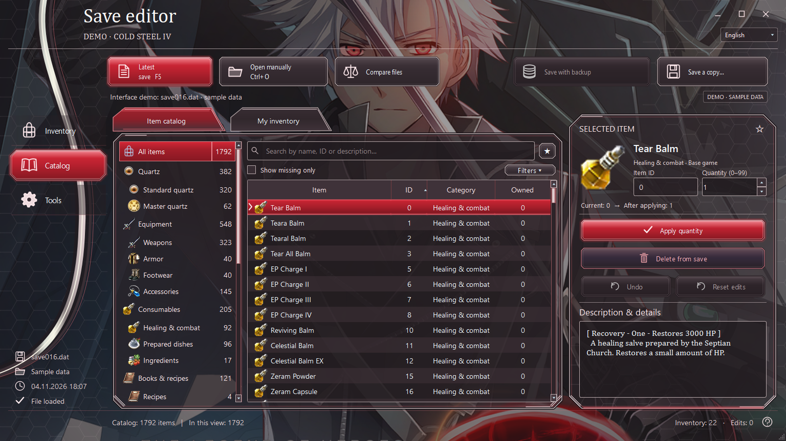
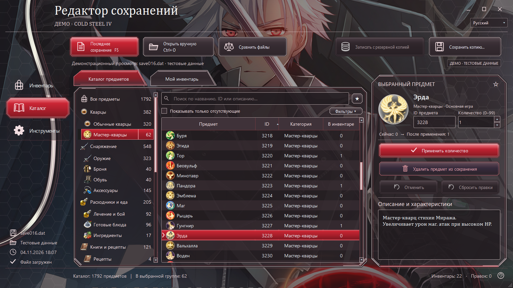
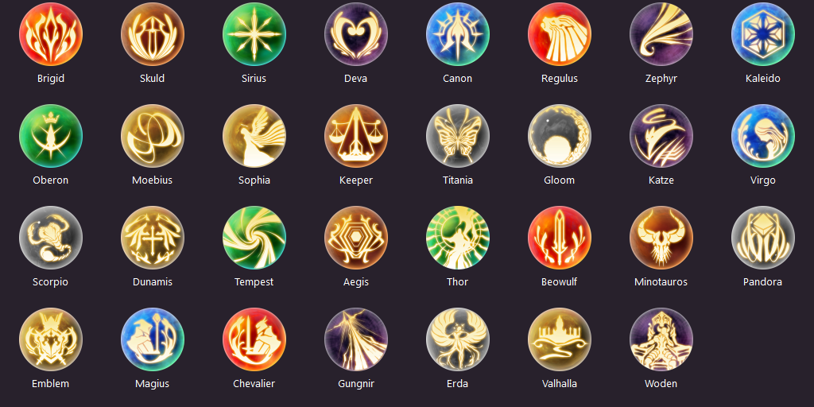

<div align="center">

# Cold Steel IV · Save Editor

**Inventory editor for The Legend of Heroes: Trails of Cold Steel IV**

Game-inspired design · Russian & English · Native Windows application

[](CHANGELOG.md)


[](LICENSE)

[Русский](README.md) · **English**

[Features](#features) · [Screenshots](#screenshots) · [Getting started](#getting-started) · [Development](#development)



*Crimson Steel: graphite panels, silver frames and crimson accents.*

</div>

Open **NISA PC** saves, browse your inventory and the installed game's item catalog, and edit items without launching CS4. Changes stay in memory until you save: undo edits, review the result and write a separate copy.

> **0.1.2 is a preview.** Parsing, writing, CRC, backups and the interface have been checked; loading an edited save in the actual game has not yet been confirmed. Use a separate save copy for your first in-game test.

## Features

| | Available functionality |
|---|---|
| **Inventory & catalog** | Search names, IDs and descriptions; categories, sorting and filters |
| **Editing** | Set quantities from 0 to 99, add/remove items and apply batch edits |
| **Change review** | Undo, reset and review every edit before writing |
| **Saving** | Separate copies; overwrite with a backup; CRC and external-change checks |
| **Convenience** | Favorites, recent items, latest-save discovery, save comparison and CSV export |
| **Two languages** | RU/EN interface with separate Russian and English catalog text |
| **DLC** | Scan installed game tables; Russian fallback text for 103 stock DLC items |
| **Master quartz** | 31 original CS4 textures; all 62 normal/EX entries checked in both languages |

## Screenshots

These are real Qt windows. The demonstrated save and inventory quantities are synthetic.

### English interface


### Russian interface



<details>
<summary><strong>All 31 original CS4 master-quartz images</strong></summary>



Normal and EX versions share their corresponding master's image. Images were extracted from the installed game, without generated or redrawn artwork.

</details>

## Getting started

### Run from source

You need **Windows**, **Python 3.10+**, and an installed copy of **Trails of Cold Steel IV — NISA PC**. Get Python from its [official website](https://www.python.org/downloads/).

```powershell
git clone https://github.com/Sqzzzzzzz/Cold-Steel-IV-Save-Editor..git Cold-Steel-IV-Save-Editor
cd Cold-Steel-IV-Save-Editor
.\Run_Qt_Preview.bat
```

On first launch, the script creates an isolated virtual environment and installs PySide6 and Pillow. This step requires an internet connection.

1. Select the game root folder containing `data`.
2. Open `saveXXX.dat` or use latest-save discovery.
3. Select an item, enter a quantity and click **Apply quantity**.
4. Review your edits and choose **Save a copy…**.

Typical save location: `%USERPROFILE%\Saved Games\FALCOM\ed8_psv4`.

**Interface preview:** run `Preview_CS4.bat`. Writing the demonstration save is disabled.

### Build a Windows EXE

```powershell
.\Build_Qt_Preview_EXE.bat
```

The script runs tests, builds the application, checks the executable and creates a ZIP. Outputs appear in `dist/` and `release/`. The compiled EXE does not require a separate Python installation. Generated executables and environments are excluded from Git.

## Catalog & languages

Base-game and DLC text comes from local `t_item.tbl` / `t_item_en.tbl` files. Game tables and personal saves are not included in this repository.

The language selector changes the interface and selects the corresponding catalog text. An incomplete English cache triggers a rescan of the selected installation. If a localization patch replaced the only English file, import an original `t_item_en.tbl` from **Tools → Import English catalog**. Russian entries are preserved.

Russian names and descriptions for 103 stock DLC items are provided as a fallback. Installed Russian text and user overrides take priority.

## Supported format

- Uncompressed **NISA PC GameData (3, 2)** saves, **1,463,976 bytes**.
- PS4, Switch, CLE and unsupported layouts are rejected.
- Writes update the checksum and preserve data outside the inventory.
- Some non-master item families still use shared CS3 artwork. Master quartz use original CS4 textures.

## Development

```powershell
python -m venv .qt-preview-venv
.\.qt-preview-venv\Scripts\python.exe -m pip install -r requirements-dev.txt
.\.qt-preview-venv\Scripts\python.exe -m pytest -q
.\.qt-preview-venv\Scripts\python.exe qt_window.py --self-test --self-test-report checks/report.json
```

Latest local validation: **84 passed, 1 skipped**. Source, compiled Windows executable and demo self-checks passed. See [Validation / Проверки](docs/VALIDATION.md) for evidence and remaining limits.

| File | Purpose |
|---|---|
| `qt_window.py` | Main window and user interaction |
| `qt_backend.py` | Catalog, languages, edit history and file operations |
| `cs4_save.py` | Save format, inventory and CRC |
| `catalog_core.py`, `game_scan.py` | Table parsing and game discovery |
| `game_icons.py`, `original_item_icons.py` | Artwork selection and verification |
| `tests/cs4/` | Regression tests |

When reporting a bug, include the editor version, steps, expected result and a screenshot. Do not post personal saves or installed game tables in issues.

## Credits & license

CS4 development and adaptation: **[Sqzzzzzzz](https://github.com/Sqzzzzzzz)**. Interface based on [Cold Steel III Inventory Editor RU/ENG](https://github.com/Sqzzzzzzz/Cold-Steel-3-Inventory-Editor-RU-ENG-).

Source code is licensed under the [MIT License](LICENSE). Game names, logos, artwork and text remain the property of their respective rights holders and are not MIT-licensed. Artwork provenance is documented in [ARTWORK.md](assets/ARTWORK.md) and the [asset manifest](icons/original/sources.json).

Technical references: [SenPatcher](https://github.com/AdmiralCurtiss/SenPatcher), [save-converters](https://github.com/ItsAllAboutTheCode/save-converters).

Unofficial project; not affiliated with Nihon Falcom or NIS America.
