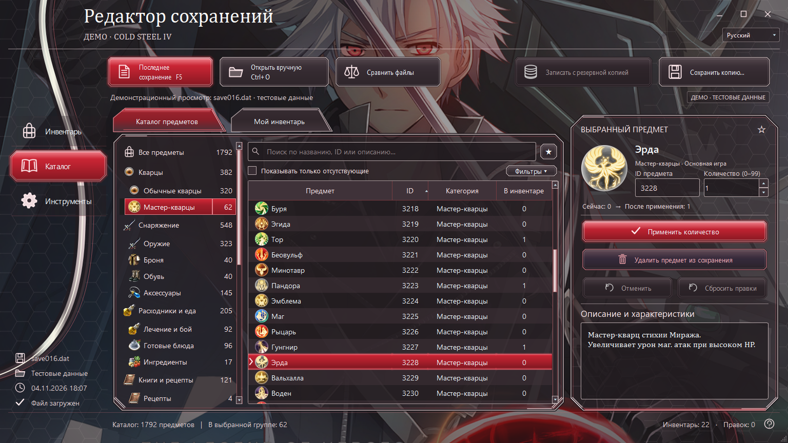

# Cold Steel IV · Inventory Editor

**Русский** · [English](README.md#english)

Редактор инвентаря **Trails of Cold Steel IV — NISA PC** с интерфейсом RU/EN.

- Количество 0–99, добавление, удаление и массовые правки.
- Поиск, категории, избранное, отмена и резервные копии.
- Игровые иконки мастер-кварцев, сравнение сохранений и CSV.

**Запуск:** [скачайте Windows ZIP](https://github.com/Sqzzzzzzz/Cold-Steel-IV-Save-Editor/releases/latest), распакуйте и откройте `CS4_Inventory_Editor.exe`. Python не нужен.

Выберите папку игры, откройте сохранение, примените изменения и нажмите **«Сохранить копию…»**.

**Требования:** Windows 10/11 x64 и установленная NISA PC-версия игры. Игровые таблицы не включены; PS4/Switch/CLE не поддерживаются. Для части категорий используются общие иконки CS3.

> Закройте игру и сделайте резервную копию сохранений. EXE не подписан сертификатом.

[Краткая инструкция](QUICK_START_RU.md)

---

[Changelog / Изменения](CHANGELOG.md) · [Development / Разработка](CONTRIBUTING.md) · [Checks / Проверки](docs/VALIDATION.md) · [Issues](https://github.com/Sqzzzzzzz/Cold-Steel-IV-Save-Editor/issues)

[Sqzzzzzzz](https://github.com/Sqzzzzzzz) · Based on / Основа: [CS3 Inventory Editor](https://github.com/Sqzzzzzzz/Cold-Steel-3-Inventory-Editor-RU-ENG-).

[MIT](LICENSE) — project code / код проекта. [Third-party notices / Сторонние компоненты](THIRD_PARTY_NOTICES.md). Unofficial project / Неофициальный проект.
